# Что даёт Agent Workflow Harness

Это пакет инструкций, навыков и вспомогательных инструментов для ИИ-агента. Он задаёт способ работы: **понять задачу → подготовить замысел → создать → проверить → исправить подтверждённые проблемы → передать результат**.

Харнесс подключается к клиенту, например Codex или Claude Code. Клиент запускает модель и предоставляет инструменты; пакет объясняет агенту, когда ими пользоваться, какие условия учитывать и что считать завершённой работой.

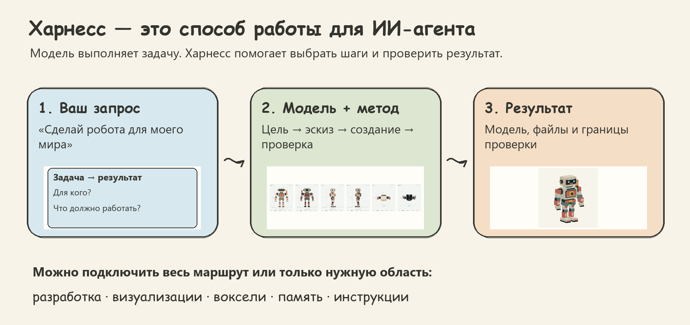

## Выберите, что хотите сделать

Профиль — готовый набор навыков для определённого круга задач.

`codex-sessions` входит в `full`, `engineering` и `instructions`: эти профили охватывают ведение разработки и работу над агентскими процедурами, включая отдельно согласованные пилоты. Оркестратор пишет бриф, запускает или продолжает видимый тред Codex и проверяет результат. Поддерживается установка для Claude и Codex. В `visual`, `voxel` и `memory` навык не выбирается: ведение сессий не является их основной задачей. Его можно добавить явно через `--skills codex-sessions`. Сам запуск требует согласия пользователя и [настроенного Codex CLI](INTEGRATIONS.md#codex-sessions-for-orchestrators).

`agent-sessions` входит в те же профили. Это общий вариант оркестратора: исполнителем может быть любой клиент, для которого есть адаптер (проверенный `codex`, непроверенный `claude-code`), а для других клиентов есть справка по написанию адаптера. Отдельно — `--skills agent-sessions`; подробнее — [интеграция](INTEGRATIONS.md#agent-sessions-for-any-worker).

| Мне нужно… | Что подключить | Что получу на выходе |
|---|---|---|
| Весь описанный способ работы | [Весь workflow](#1-весь-workflow) · `full` | Общий маршрут и все профильные навыки |
| Сайт, приложение, фича или исправление | [Разработка](#2-разработка) · `engineering` | Рабочий сценарий, проверки и инструкция запуска |
| Дашборд, интерактивная схема или визуальный мир | [Визуальное объяснение](#3-визуальное-объяснение) · `visual` | Понятное действие и видимое следствие |
| Воксельная модель или набор объектов | [Воксели](#4-воксельные-модели) · `voxel` | Согласованные 2D-виды, объём и редактируемые файлы |
| Продолжать проекты без пересказа контекста | [Память](#5-память-и-продолжение) · `memory` | Найденные решения и подтверждённые новые записи |
| Научить агента повторяемой процедуре | [Инструкции](#6-инструкции-и-навыки) · `instructions` | Условия применения, шаги, критерии и примеры |

**Как читать схемы:** слева — действие агента, справа — то, что появляется после него. Стрелка ведёт к следующему этапу. Существенная проблема возвращает работу к проверке причины и исправлению.

На схемах показан развёрнутый путь. Участие пользователя и отдельного проверяющего выбираются по задаче; пилот не является обязательным этапом правки инструкций. Установка зависимостей сохраняет доступность справок, а не требует загружать все навыки в контекст. Для маленькой ясной правки используются относящиеся к ней этапы. Робот и сайт ниже — реальные результаты наших задач; карточки краткого задания, плана и записи памяти иллюстрируют форму выхода.

## 1. Весь workflow

**Например:** «Сделай робота-помощника для моего воксельного мира».

Агент восстанавливает условия, исследует конкретные неизвестные, показывает связный замысел, создаёт результат и сам его проверяет. Свежий независимый ревьюер получает исходную задачу и ожидаемые свойства результата. Его запуск зависит от разрешения владельца и возможностей клиента.

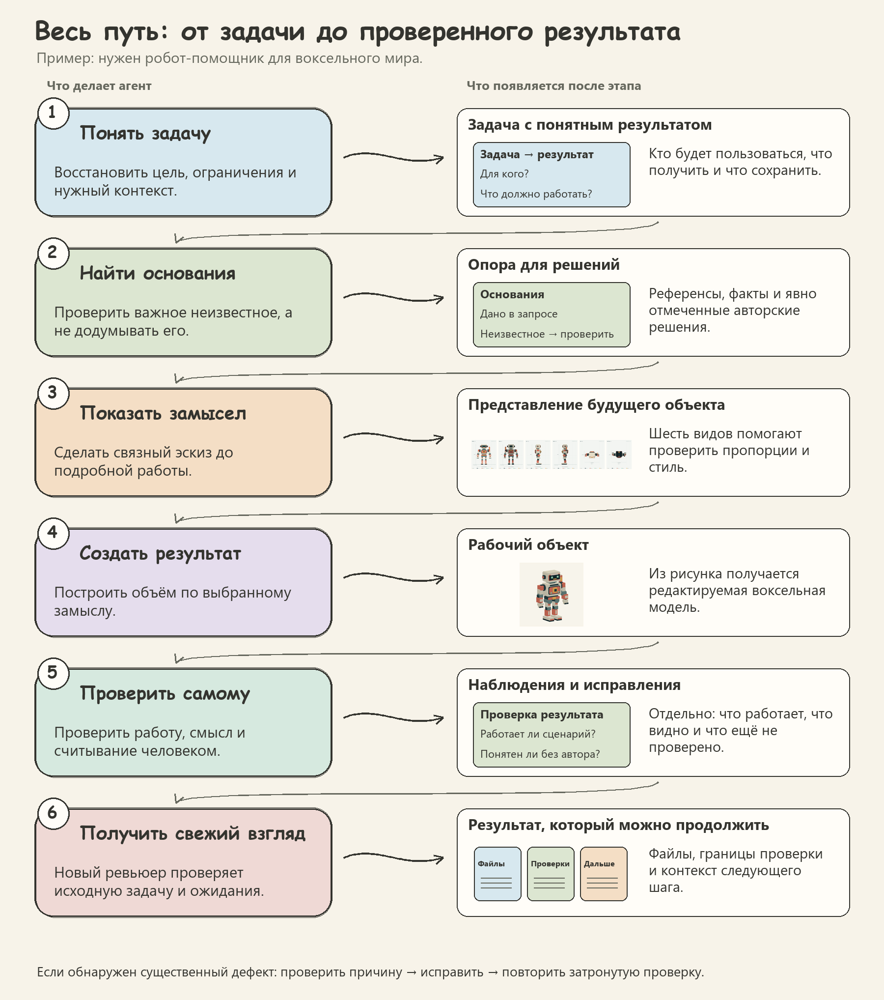

**Зачем это нужно:** у результата есть основания, промежуточная форма и проверка по задаче. Наблюдение ревьюера сначала проверяется; исправление следует за установленной причиной.

<details>
<summary>Что входит в профиль и как посмотреть план установки</summary>

Профиль `full`: 26 выбрано → 26 навыков с зависимостями.

**Основной выбор:** `agent-sessions`, `anthropic-workflow-creator`, `codex-sessions`, `creative-direction`, `design-taste-frontend-v1`, `domain-modeling`, `grill-with-docs`, `grilling`, `handoff`, `kb-curate`, `kb-find`, `kb-save`, `kb-status`, `kb-sync`, `lab-vm-control`, `product-debugging`, `product-engineering`, `product-implementation`, `product-planning`, `product-testing`, `product-ui-design`, `product-ui-review`, `ui-ux-pro-max`, `visual-experiment-craft`, `voxel-model-craft`, `writing-for-agents`.

**Связанные навыки:** дополнительных нет.

Из папки скачанного репозитория можно сначала посмотреть план, заменив путь и клиент на свои:

```bash
python harness.py plan --client codex --target /path/to/project --profile full
```

Установка — по [пошаговому руководству для агента](../INSTALL_FOR_AGENTS.md). Интеграции и доступы настраиваются отдельно под владельца.

</details>


## 2. Разработка

**Например:** «Сделай лендинг груминга, где посетитель выбирает размер собаки и видит цену».

Профиль связывает пользовательский сценарий, реализацию и проверку. Для интерфейса подключаются дизайн и фактический осмотр; при неисправности — диагностика.

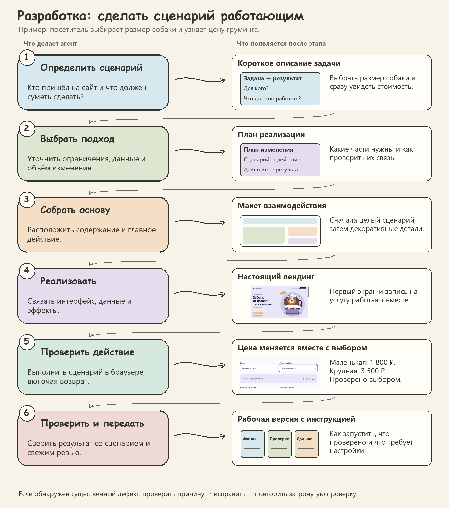

**Вот реальный результат этапа реализации:** первый экран демонстрационного салона «Лапа & Пена».

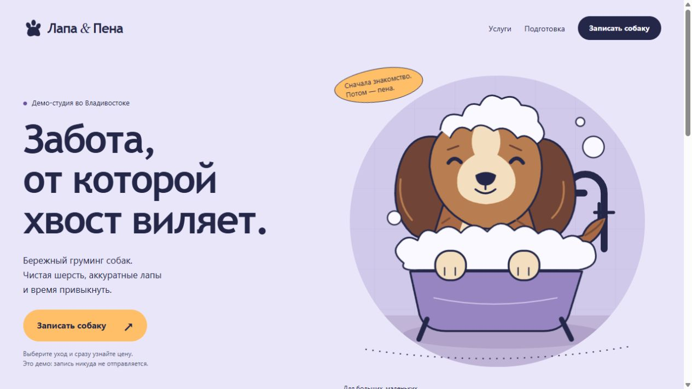

**Вот результат проверки действия:** выбор «Крупная собака» показывает 3 500 ₽; возврат к «Маленькая собака» — 1 800 ₽. Эти переключения выполнены в браузере. Запись в салон не отправлялась; пример демонстрирует интерфейс.

<details>
<summary>Что входит в профиль и как посмотреть план установки</summary>

Профиль `engineering`: 12 выбрано → 16 навыков с зависимостями.

**Основной выбор:** `agent-sessions`, `codex-sessions`, `creative-direction`, `domain-modeling`, `product-debugging`, `product-engineering`, `product-implementation`, `product-planning`, `product-testing`, `product-ui-design`, `product-ui-review`, `ui-ux-pro-max`, `writing-for-agents`.

**Связанные навыки:** `design-taste-frontend-v1`, `kb-find`, `visual-experiment-craft`, `voxel-model-craft`.

Из папки скачанного репозитория можно сначала посмотреть план, заменив путь и клиент на свои:

```bash
python harness.py plan --client codex --target /path/to/project --profile engineering
```

Установка — по [пошаговому руководству для агента](../INSTALL_FOR_AGENTS.md). Интеграции и доступы настраиваются отдельно под владельца.

</details>


## 3. Визуальное объяснение

**Например:** «Сделай так, чтобы посетитель сразу понял, как выбор влияет на стоимость».

Сначала выбирается вопрос зрителя, затем связь между действием и результатом, затем композиция. Этот принцип применяется к дашбордам, интерактивным схемам и мирам; ниже — небольшой пример на том же сайте.

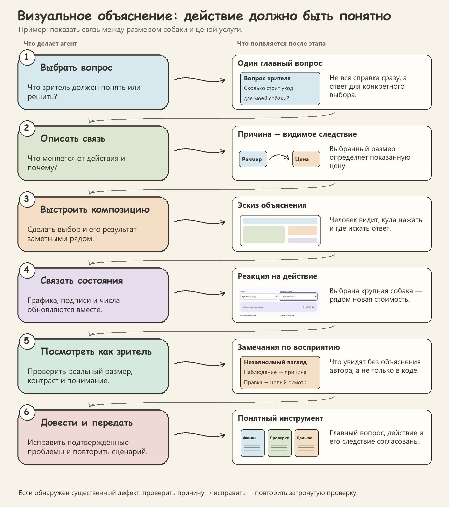

**Видимое следствие:** выбранный размер и рассчитанная цена находятся в одном окне.

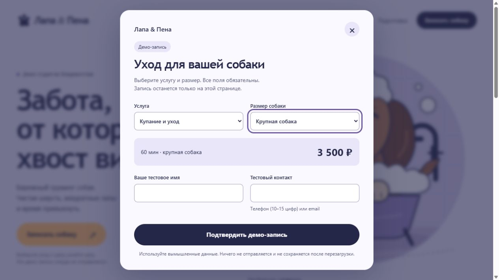

**Зачем это нужно:** зритель видит, что можно изменить и где искать результат. Качество проверяется в реальном размере и действием; отдельно оцениваются стиль, смысл и лёгкость понимания.

<details>
<summary>Что входит в профиль и как посмотреть план установки</summary>

Профиль `visual`: 5 выбрано → 14 навыков с зависимостями.

**Основной выбор:** `creative-direction`, `product-ui-design`, `product-ui-review`, `visual-experiment-craft`, `voxel-model-craft`.

**Связанные навыки:** `design-taste-frontend-v1`, `domain-modeling`, `kb-find`, `product-debugging`, `product-engineering`, `product-implementation`, `product-planning`, `product-testing`, `ui-ux-pro-max`.

Из папки скачанного репозитория можно сначала посмотреть план, заменив путь и клиент на свои:

```bash
python harness.py plan --client codex --target /path/to/project --profile visual
```

Установка — по [пошаговому руководству для агента](../INSTALL_FOR_AGENTS.md). Интеграции и доступы настраиваются отдельно под владельца.

</details>


## 4. Воксельные модели

**Например:** «Создай стилизованного робота в масштабе нашего набора».

Воксельная модель собирается из объёмных ячеек. До подробного построения агент фиксирует характер и масштаб, затем готовит согласованные виды со всех сторон.

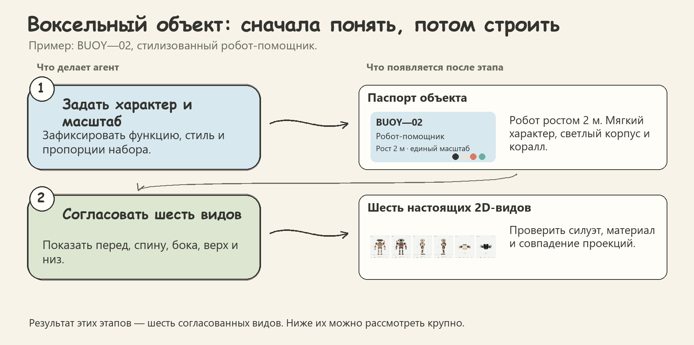

**Результат этапа 2 — шесть 2D-видов BUOY—02:** перед, спина, левый и правый бок, верх и низ. По ним можно проверить пропорции и материал до создания объёма.

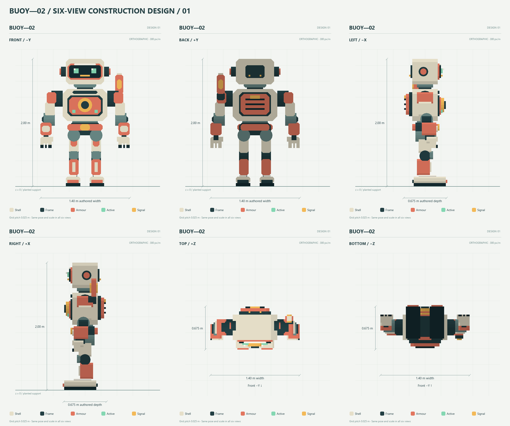

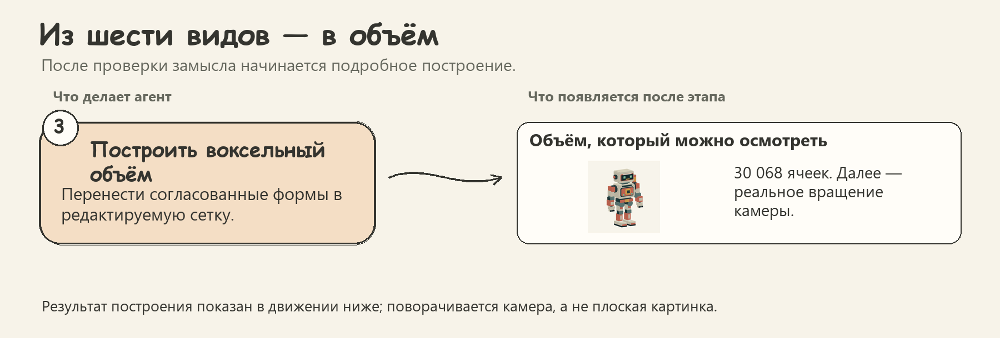

**Результат этапа 3 — построенный объём.** В анимации камера обходит исходную модель; видно, как спроектированные стороны соединяются в одного робота.

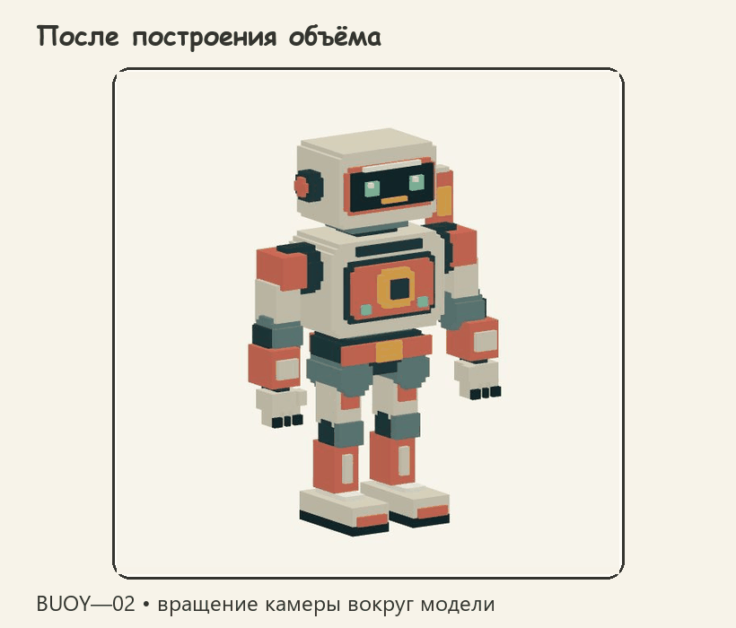

[Неподвижный вид модели](assets/profiles-v2/robot-turntable-still.png).

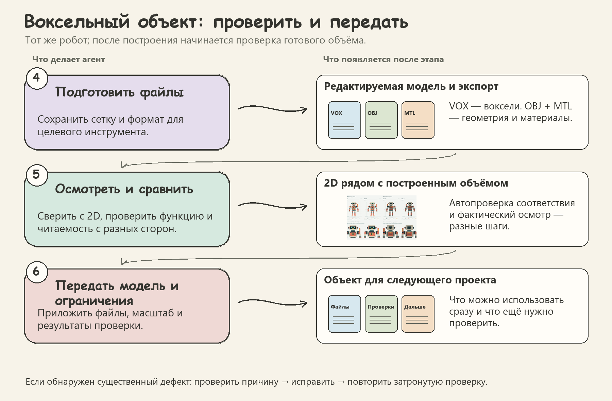

**Результат этапа 5 — сравнение 2D и 3D.** [Открыть полный лист сравнения](assets/profiles-v2/robot-comparison.png). Совпадение с чертежом и хорошее считывание человеком проверяются отдельно.

**На выходе:** редактируемая модель, нужный экспорт, масштаб и ограничения проверки. В примере используются VOX для воксельного редактора и OBJ + MTL для геометрии и материалов.

<details>
<summary>Что входит в профиль и как посмотреть план установки</summary>

Профиль `voxel`: 2 выбрано → 14 навыков с зависимостями.

**Основной выбор:** `creative-direction`, `voxel-model-craft`.

**Связанные навыки:** `design-taste-frontend-v1`, `domain-modeling`, `kb-find`, `product-debugging`, `product-engineering`, `product-implementation`, `product-planning`, `product-testing`, `product-ui-design`, `product-ui-review`, `ui-ux-pro-max`, `visual-experiment-craft`.

Из папки скачанного репозитория можно сначала посмотреть план, заменив путь и клиент на свои:

```bash
python harness.py plan --client codex --target /path/to/project --profile voxel
```

Установка — по [пошаговому руководству для агента](../INSTALL_FOR_AGENTS.md). Интеграции и доступы настраиваются отдельно под владельца.

</details>


## 5. Память и продолжение

**Например:** «Продолжи проект: вспомни, что мы решили, и сохрани сегодняшнее изменение».

Агент находит относящиеся к задаче заметки, сверяет их с текущим состоянием, записывает новое с источником и проверяет сохранение. Так следующий чат получает решения и ссылки на материалы.

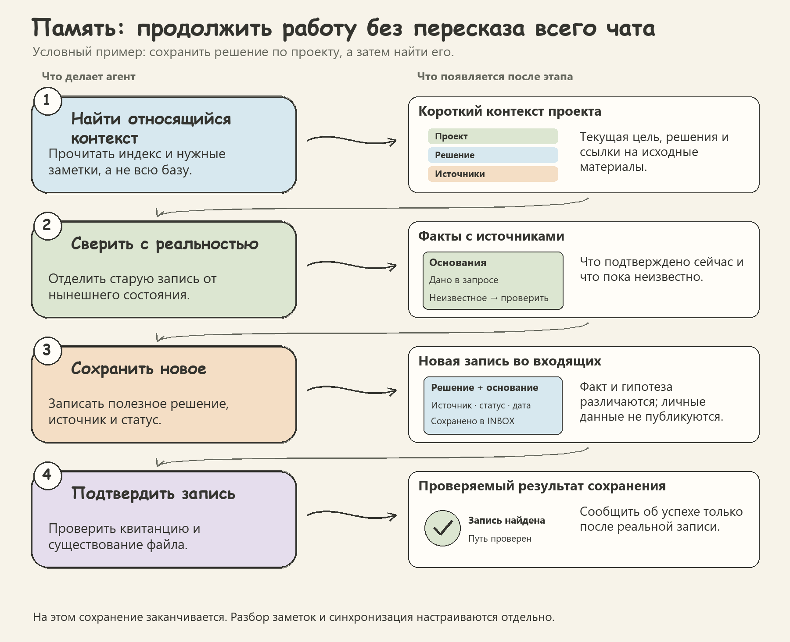

**Отдельно настраивается обслуживание базы:** разбор входящих заметок и обмен приватными копиями. Это самостоятельные процессы.

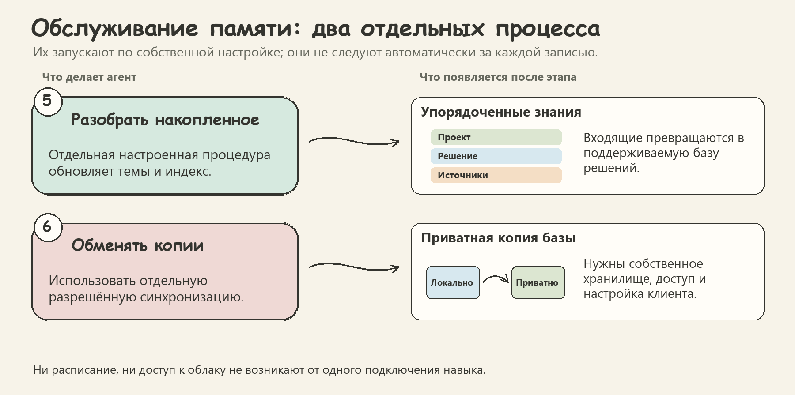

Пример полностью условный. При установке используется собственная разрешённая база; подключение навыка само по себе не создаёт облачное хранилище или расписание.

<details>
<summary>Что входит в профиль и как посмотреть план установки</summary>

Профиль `memory`: 5 выбрано → 5 навыков с зависимостями.

**Основной выбор:** `kb-curate`, `kb-find`, `kb-save`, `kb-status`, `kb-sync`.

**Связанные навыки:** дополнительных нет.

Из папки скачанного репозитория можно сначала посмотреть план, заменив путь и клиент на свои:

```bash
python harness.py plan --client codex --target /path/to/project --profile memory
```

Установка — по [пошаговому руководству для агента](../INSTALL_FOR_AGENTS.md). Интеграции и доступы настраиваются отдельно под владельца.

</details>


## 6. Инструкции и навыки

**Например:** «Сохрани наш подход к проектированию модели, чтобы другой агент мог его повторить».

Инструкция указывает, когда применять процедуру, какие входные данные нужны, что сделать и по чему проверить завершение. Примеры поясняют принцип; отдельно согласованный пилот проверяет гипотезу об улучшении процесса. Редактура документов следует writing-for-agents, создание навыка — доступному native skill-creator; Anthropic-вход ведёт к единому порядку пилота.

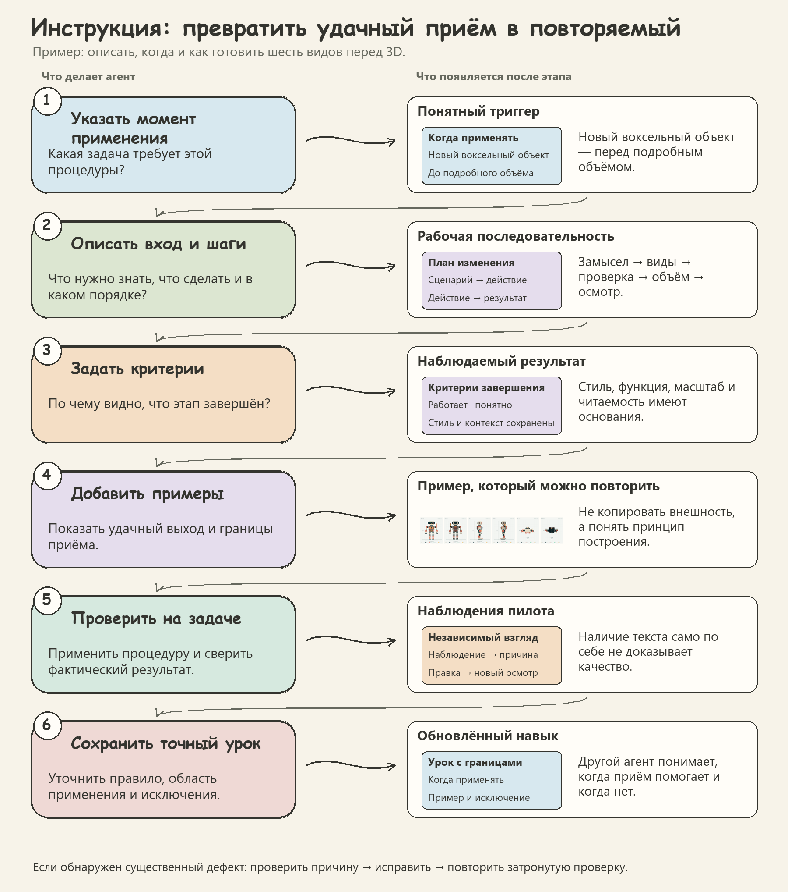

**Зачем это нужно:** удачный приём становится воспроизводимой процедурой с областью применения и исключениями. Новая задача проверяется, когда это нужно для гипотезы и отдельно разрешено; обычная правка проходит затронутые локальные проверки.

<details>
<summary>Что входит в профиль и как посмотреть план установки</summary>

Профиль `instructions`: 3 выбрано → 17 навыков с зависимостями.

**Основной выбор:** `agent-sessions`, `anthropic-workflow-creator`, `codex-sessions`, `writing-for-agents`.

**Связанные навыки:** `creative-direction`, `design-taste-frontend-v1`, `domain-modeling`, `kb-find`, `product-debugging`, `product-engineering`, `product-implementation`, `product-planning`, `product-testing`, `product-ui-design`, `product-ui-review`, `ui-ux-pro-max`, `visual-experiment-craft`, `voxel-model-craft`.

Из папки скачанного репозитория можно сначала посмотреть план, заменив путь и клиент на свои:

```bash
python harness.py plan --client codex --target /path/to/project --profile instructions
```

Установка — по [пошаговому руководству для агента](../INSTALL_FOR_AGENTS.md). Интеграции и доступы настраиваются отдельно под владельца.

</details>


## Как подключить

Сначала выберите клиент и нужный состав, затем передайте агенту [руководство установки](../INSTALL_FOR_AGENTS.md). Там описаны предварительный план, установка, проверка и настройка интеграций.

- **`full`** подключает общий workflow и весь набор навыков.
- **Остальные профили** устанавливают выбранные навыки и их зависимости. Полный общий маршрут включается отдельно флагом `--workflow`; при этом устанавливаются все 25 модулей.
- **`--skills <имя>`** выбирает отдельный навык с его зависимостями.

Установленные файлы доступны агенту; в контекст он читает относящиеся к текущему этапу материалы. Возможности модели, инструменты и разрешения определяются вашим клиентом и настройкой.

[Полное рабочее руководство](WORKFLOW_GUIDE.md) · [Подключения](INTEGRATIONS.md) · [Совместимость](COMPATIBILITY.md)

<details>
<summary>Происхождение примеров, точный состав и границы доказательств</summary>

**Состав профилей** вычислен из установщика версии `0.5.0`. Числа — выбранные навыки → полный состав с зависимостями:

| full | engineering | visual | voxel | memory | instructions |
|---:|---:|---:|---:|---:|---:|
| 26 → 26 | 13 → 17 | 5 → 14 | 2 → 14 | 5 → 5 | 4 → 18 |

**Робот:** BUOY—02 из собственного бенчмарка Ultra A, сохранённые 2D-виды и исходная grid. 30 068 занятых ячеек; шаг 0,025 м; габариты занятого объёма 1,40 × 0,675 × 2,00 м. Для GIF сняты 36 ракурсов нативного WebGL-просмотра с шагом камеры 10°. Геометрия исходника сохранена. Это поворот камеры, анимация суставов здесь не показана; проверка рига, FPS и импорта в сторонний редактор этим документом не подтверждается.

**Сайт:** собственный демонстрационный лендинг груминга Ultra A. При подготовке документа сняты первый экран и форма, выполнено переключение размера крупная → маленькая собака. Персональные поля не заполнялись, запись не отправлялась. Скриншот показывает конкретное состояние; он не доказывает полную приёмку сайта или качество любого будущего результата.

**Схемы:** оригинальная инфографика для объяснения метода. Карточки задания, плана, заметок и проверки — иллюстрации типов выхода, а не журнал фактического исполнения именно этих задач. Референсы пользователя послужили ориентиром композиции и рисованного стиля; сами изображения референсов в пакет не включены. Личная база, рабочие документы и сторонние модели не использованы.

**Состояние пакета:** версия `0.5.0` добавляет agent-sessions — оркестрацию исполнителей в любых клиентах через адаптеры. Версия `0.4.0` добавила codex-sessions для брифа, запуска/продолжения видимого треда Codex и проверки результата. Сохраняется обновление `0.3.0`: creative-direction, проверка замысла и сохранения принятого результата, устранение личных привязок. Сохранены текущие уточнения о крупных границах материалов и разных воксельных сетках, а также поиск current/history, проверка навигации и структурного покрытия памяти. Для реестров используются собственные данные владельца и синтетические шаблоны структуры. Общий workflow сохранён; изменения описаны в [истории выпусков](../CHANGELOG.md).

**Границы:** инструкция не гарантирует одинаковый творческий результат на разных моделях. Хеши и проверки файлов подтверждают целостность пакета; фактические действия, визуальный осмотр и обратная связь пользователя дают разные виды свидетельств. Браузер, просмотр изображений, генерация графики и новый контекст ревьюера должны реально предоставляться клиентом. Память, синхронизация и постоянные доступы требуют настройки владельцем.

[Контракт сохранности метода](FIDELITY.md) · [Проверки выпуска](VALIDATION.md)

</details>
