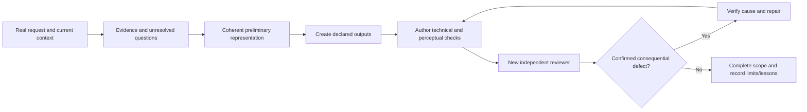

# Understand and apply the preserved workflow

This is a navigation guide. The complete installed base, WORKFLOW.md, relevant SKILL.md and referenced method files remain the operative instructions. Do not substitute this overview for them.

## Context loads in layers

| When | Load | Purpose |
|---|---|---|
| Session startup in full mode | Complete base rules + local deployment policy | Communication, scope, permissions, memory and task routing |
| Multi-stage/new/ambiguous/repeated-failure/resumed task | workflow/WORKFLOW.md + relevant current project decisions | Goal, evidence, research, representation, completeness, recovery |
| Actual stage of work | Relevant SKILL.md entrypoint | Stage-specific actions and criteria |
| Trigger in that entrypoint | Required reference, helper or targeted dataset query | Concrete method; not an unconditional context dump |
| Acceptance | Actual artifact/behavior + independent-review.md | Author testing, clear reviewer brief, fresh observations and verified causes |
| Completion/handoff | Current state, real receipts and bounded transferable lessons | Recovery and continuity without fabricated completion |

Installed modules are not all loaded into the model at once. Installation closure preserves reachability; original triggers govern reading. The package adds no model dispatcher and no automatic role/cost routing.

## Main cycle

The new acceptance round after a repair gets a new reviewer. Ordinary small edits use the relevant stage and proportionate checks. A review-only request does not authorize implementation; permission files and source history do not create tool rights.

Research is triggered by concrete unresolved function, structure, style/context, references, discrepancy or a failed bounded experiment. Record what is unknown and what evidence resolves it. Do not treat a vague feeling of understanding as a sufficient factual basis. Reference quality and inferred causes remain distinguishable.

Before expensive construction, validate a cheap coherent representation at the required scale/style/context. For voxel creation this includes six 2D sides, proportions against the existing kit/world, an actual view review and preflight validation before detailed 3D geometry. Existing accepted recipes may be reproduced as regressions; a new design still needs its own preflight.

## Module map

| Goal/stage | Entry points |
|---|---|
| Route a development task | product-engineering |
| Scope and architecture | product-planning; domain-modeling when meaningful terminology/decision is involved |
| Implement agreed behavior | product-implementation |
| Diagnose observed failure | product-debugging |
| Behavior/code verification | product-testing |
| Interface decisions and build | product-ui-design; targeted ui-ux-pro-max search; optional design-taste-frontend-v1 |
| Rendered interface/interaction review | product-ui-review |
| Interactive explanation, spatial world, material/light experiment | visual-experiment-craft |
| Voxel grid/model/modular kit/creature/diorama | voxel-model-craft |
| Agent instructions and reusable workflows | writing-for-agents; anthropic-workflow-creator; native skill-creator for skill structure |
| Deliberate decision stress-test/document interview | grilling; grill-with-docs only when selected |
| Explicit handoff | handoff |
| Personal project context and saving | kb-find; kb-save |
| Maintenance/status/private sync | kb-curate; kb-status; kb-sync in their authorized scope |
| Existing restricted laboratory provider | lab-vm-control |

An interface attached to research uses the UI route because the result contains an interface. Mentioning a technology in a creative or household task does not force the engineering route. A backend-only task does not acquire UI obligations. Full native format/provider dependencies are documented in COMPATIBILITY.md and INTEGRATIONS.md.

## Technical pass is not human comprehension

Separate technical behavior, meaning/context, actual rendered perception and a real human verdict. A viewer sees silhouette/recognition/relationships before tiny details; inspect under the declared audience, distance, viewport and attention conditions. Ask what the artifact resembles without its label. Examine intended strangeness before calling it a defect.

Observe before diagnosing. A perspective image can show an ambiguous alignment; coordinate/grid evidence determines geometry. A present eye or button can remain unreadable. Repeated symptoms become a system class, not a quota of findings. Preserve successful identity, style and relationships when fixing confirmed problems. Do not universalize one model's wear/smoke/color solution into all tasks.

For UI verify the actual primary action and visible consequence, relevant failure/recovery, consistent state/labels/charts, readable hierarchy, input and keyboard behavior, and motion over time. For a world verify meaning/zoning, navigable relationships, grounded layout, life/animation and personal anchors from the authorized brief. For voxel assets inspect matched views, head/grip/collision/scale/readability and category contact sheets as applicable. Concrete criteria live in the original method references.

## Reviewer brief

Give a newly created context the original task, material corrections, actual expected output/behavior, intended audience/style/conditions, constraints, version/path/launch and review scope. Do not preload author self-assessment or earlier conclusions before first impression. The author owns technical tests; the reviewer independently observes and checks the specified expectations. Findings need evidence and impact, not an invented quota. Verify cause before repair and retain failed-version evidence.

## Completion and learning

State declares outputs/stages and relevant dependencies; the quality ledger binds evidence to exact files. Modified sources/renders invalidate old related observations; unchanged unrelated evidence can remain only when independence is actually established. State/ledger helpers validate records and freshness, not beauty or authenticity of a human claim. The quality Stop hook diagnoses and does not revive paused/cancelled tasks or run an unbounded repair loop.

Save factual results, decisions, preferences and bounded lessons to the authorized INBOX with source and status. Keep hypothesis separate; use checkpoint when nothing new should be saved. Record receipt/read-back. Private sync and curator/scheduler actions are distinct, configured operations. Transfer a lesson's applicability and exceptions, not a claim that a model has acquired new weights.
