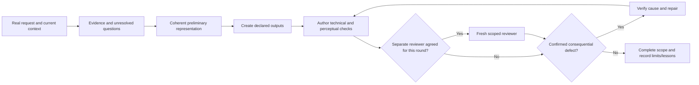

# Understand and apply the preserved workflow

This is a navigation guide. The complete installed base, WORKFLOW.md, relevant SKILL.md and referenced method files remain the operative instructions. Do not substitute this overview for them.

## Context loads in layers

Loading/recovery: see [WORKFLOW, step 2](../payload/workflow/WORKFLOW.md#work-route). The table below describes installed layers.

| When | Load | Purpose |
|---|---|---|
| Session startup in full mode | Complete base rules + local deployment policy | Communication, scope, permissions, memory and task routing |
| Multi-stage/new/ambiguous/repeated-failure/resumed task | workflow/WORKFLOW.md + relevant current project decisions | Goal, evidence, research, representation, completeness, recovery |
| Actual stage of work | Relevant SKILL.md entrypoint | Stage-specific actions and criteria |
| Trigger in that entrypoint | Required reference, helper or targeted dataset query | Concrete method; not an unconditional context dump |
| Acceptance | Actual artifact/behavior + saved acceptance program | Author checks and selected human checkpoints; independent-review.md only for explicitly agreed review |
| Completion/handoff | Current state, real receipts and bounded transferable lessons | Recovery and continuity without fabricated completion |

Installation preserves reference reachability; loading follows that owner.

## Main cycle

Participation/reviewer selection: see [task-brief-and-acceptance, 5. Two decisions about how to work](../payload/skills/dev-flow/references/task-brief-and-acceptance.md#5-two-decisions-about-how-to-work). Reviewer rounds: see [independent-review, After the report](../payload/workflow/independent-review.md#after-the-report). Action scope: see [AGENTS, Goal, communication and boundaries](../payload/AGENTS.md#goal-communication-and-boundaries).

Research triggers: see [reference-grounding, Observable triggers](../payload/skills/dev-flow/references/reference-grounding.md#observable-triggers).

Cheap representation: see task brief and acceptance, section 6. Voxel representation/reuse: see [voxel preflight](../payload/skills/voxel-models/references/design-preflight.md).

## Module map

| Goal/stage | Entry points |
|---|---|
| Route a development task | dev-flow |
| Scope and architecture | dev-plan; dev-domain-model when meaningful terminology/decision is involved |
| Implement agreed behavior | dev-implement |
| Diagnose observed failure | dev-debug |
| Behavior/code verification | dev-verify |
| Open creative concept: interface, game, content, motion or 3D | creative-direction; keep an accepted direction as the basis |
| Interface decisions and build | ui-design; targeted ui-reference search; optional ui-taste-reference |
| Rendered interface/interaction review | ui-review |
| Interactive explanation, spatial world, material/light experiment | visual-scenes |
| Voxel grid/model/modular kit/creature/diorama | voxel-models |
| Agent documents | [agent-instructions](../payload/skills/agent-instructions/SKILL.md) |
| Codex skill creation | Native skill-creator when actually supplied by the client |
| Workflow experiments | [workflow-pilot](../payload/skills/dev-flow/references/workflow-pilot.md) |
| Deliberate decision stress-test/document interview | stress-test; stress-test-with-docs only when selected |
| Explicit handoff | agent-handoff |
| User-requested work in a Codex thread visible in the app | agent-sessions-codex; write the brief, start/resume the thread and verify its result |
| Personal project context and saving | kb-find; kb-save |
| Maintenance/status/private sync | kb-curate; kb-status; kb-sync in their authorized scope |

An interface attached to research uses the UI route because the result contains an interface. Mentioning a technology in a creative or household task does not force the engineering route. A backend-only task does not acquire UI obligations. Full native format/provider dependencies are documented in COMPATIBILITY.md and INTEGRATIONS.md.

## Technical pass is not human comprehension

Claim grades: see [human-perspective-review, Readiness and transfer](../payload/skills/dev-flow/references/human-perspective-review.md#readiness-and-transfer).

Observation and interpretation: see [human-perspective-review, Inspection sequence](../payload/skills/dev-flow/references/human-perspective-review.md#inspection-sequence).

UI: see [ui-review](../payload/skills/ui-review/SKILL.md) and [UI design preflight, section 4](../payload/skills/ui-design/references/design-preflight.md#4-compare-the-working-ui-with-the-basis). Worlds: see visual-scenes, World scenes. Voxels: see voxel-models, Choose the relevant branch.

## Reviewer brief, only when selected

Preparation and information staging: see [independent-review, Preparation](../payload/workflow/independent-review.md#preparation); observation: see human-perspective-review, Inspection sequence.

## Completion and learning

Task records: see [task-state, Long-task state and completeness](../payload/skills/dev-flow/references/task-state.md#long-task-state-and-completeness). Evidence versions: see [quality-ledger, Schema version 1](../payload/skills/dev-flow/references/quality-ledger.md#schema-version-1). The optional quality Stop hook diagnoses state; it does not resume tasks.

Persistence: see [kb-save, Knowledge capture](../payload/skills/kb-save/SKILL.md#knowledge-capture). Transport: see [kb-sync, Knowledge transport](../payload/skills/kb-sync/SKILL.md#knowledge-transport). Curation: see [kb-curate, Knowledge curation](../payload/skills/kb-curate/SKILL.md#knowledge-curation).

[Instruction ownership and the single pilot](INSTRUCTION_MAINTENANCE.md) explains the shared procedures and validation limits.
